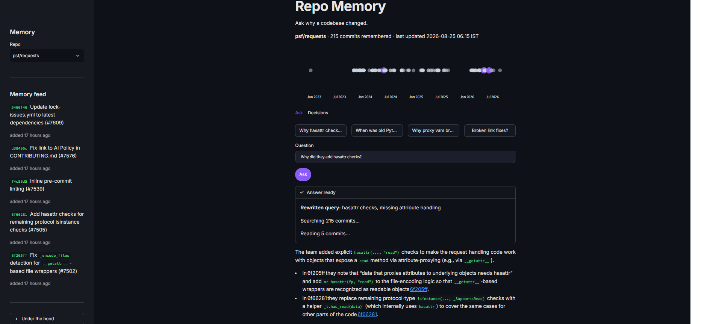
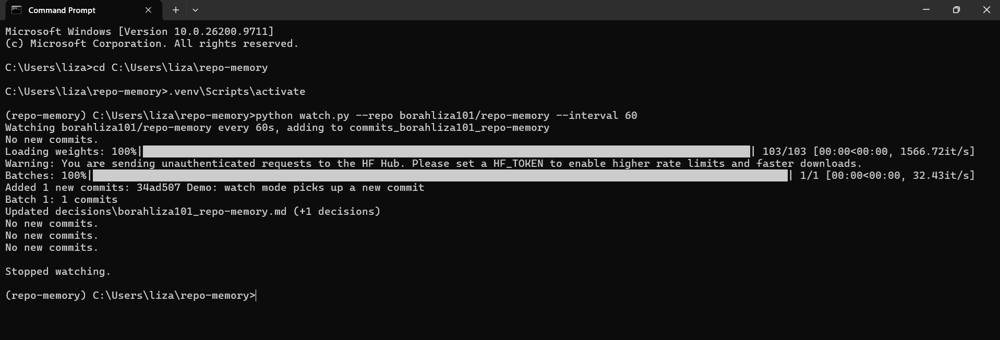
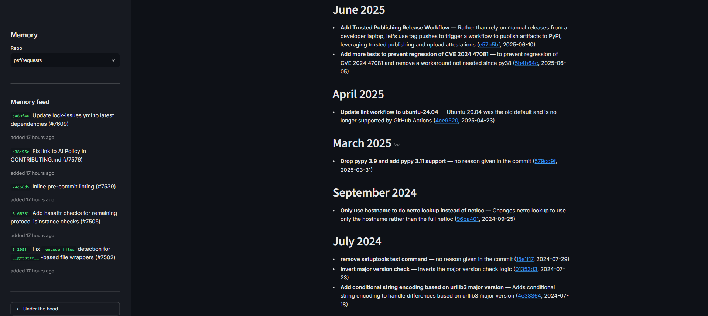
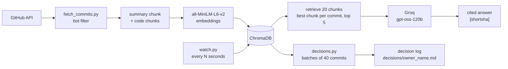

# Repo Memory

A codebase that remembers why it changed.







## The problem

Every project carries a history of changes, and the reason behind most of them is buried in old commits. When someone asks "why is this code written like this?", nobody has time to scroll through hundreds of diffs.

It is like a group chat with two years of messages: the answer is in there somewhere, but you cannot find it.

## What it does

- **Ask questions in plain English.** Answers come only from commits in the memory, and every claim cites a commit as `[6f66281]`, which is a clickable link to GitHub.
- **Refuses to guess.** If the stored commits do not contain the answer, it replies "I couldn't find this in the history" instead of inventing one.
- **Watch mode.** `watch.py` polls GitHub, compares the last 100 commits with the memory, and adds the missing ones live, without rebuilding.
- **Commit timeline.** Every commit in the memory is a dot on a date axis; after an answer, the commits it used light up and the rest fade.
- **Memory feed.** The sidebar shows the five most recently added commits with "added N minutes ago", refreshing every 30 seconds.
- **Decision log.** `decisions.py` turns the commit memory into a month-by-month log of design decisions, each with a reason and citations.
- **Works on any public repo.** Every script takes `--repo owner/name`, and each repo gets its own ChromaDB collection.
- **Remember a new repo from the UI.** Paste a GitHub URL in the sidebar, pick how many recent commits to read, and press "Build memory". The repo is fetched, embedded and added to the dropdown. If it is already in memory the button says "Update" and only adds the commits you are missing. On a fresh install the same form is the welcome screen, so there is no command line needed to get started.

## How it works



Each commit becomes one short summary chunk (message plus changed filenames) and one or more code chunks (2000 characters, 200 overlap, each patch cut at 3000 characters). Short summary chunks matter: without them, long diffs drowned out the commit message.

## Evaluation journey

I wrote five questions in my own words, without copying any words from the commit messages, and counted how often the right commit appeared in the top 5.

| Commit | Topic | Before fixes | After fixes |
| --- | --- | --- | --- |
| dc9dbdf | 3.15 support | no | no (the question is ambiguous) |
| 5f3ff9b | typo fixes | no | yes, rank 1 |
| 25340eb | proxy vars in tests | no | yes, rank 4 |
| fd62809 | leading slashes | no | no (vocabulary gap) |
| d38495c | broken link | yes | no (all five results were real broken-link fixes) |

**Score: 1/5 -> 2/5** after adding summary chunks, skipping dependabot merges, and keeping only the best chunk per commit. On the three questions with exactly one correct answer, the score was 2/3.

Then I caught data leakage in my own evaluation: the query-rewriting prompt used one of my test questions as its example, which made the rewrite look better than it was. I replaced the example and re-ran with `temperature=0`. The honest result was **2/5 without rewriting, 2/5 with rewriting**. An earlier run at the default temperature had scored 3/5 by finding the leading-slash commit at rank 2; that result does not reproduce at temperature 0, so it was sampling luck, not a real improvement.

The real lesson: five questions is far too few. A 1/5 versus 2/5 difference is one question, and ambiguous questions quietly punish correct retrieval.

## Engineering problems I hit and fixed

- **Bot filter false positives.** Skipping any message containing "dependabot" dropped two of my own commits that merely mentioned it. The filter now skips only bot accounts (`[bot]` logins) and real dependabot merges ("Merge pull request" plus "/dependabot/"). On psf/requests that changed skipped commits from 30 to 28; on my repo from 2 wrongly dropped to 0.
- **The watcher lost commits.** It used the newest stored commit as a cursor, so anything older that was missing could never be recovered (`f780219` and `a1a8af6` disappeared this way). It now fetches the last 100 commits every check, compares full sha sets with the collection, and adds every missing non-bot commit.
- **The app searched a stale index.** The app and the watcher are separate processes, and ChromaDB caches its vector index per process, so the app counted 13 commits but searched only 11 until restart. It now clears Chroma's shared system cache before each query; verified with a two-process test.

## Limitations and next steps

- **Commit messages rarely say why.** Most describe what changed. The reasons usually live in pull request descriptions and code comments, so fetching PR bodies is the highest-value next step.
- **The evaluation is tiny.** Five hand-written questions on one library. I need a wider, versioned set across several repos, with questions that have exactly one correct answer.
- **Small embedding model.** `all-MiniLM-L6-v2` misses vocabulary gaps ("start of a web address" versus "leading slashes in path_url"). Query rewriting helps sometimes, but a larger model is the more direct fix.
- **The decision log is only as good as the commits.** Many entries honestly say "no reason given in the commit", because that is all the history contains.

## How to run it

```bash
uv venv
source .venv/bin/activate          # Windows: .venv\Scripts\activate
uv pip install requests python-dotenv chromadb sentence-transformers groq plotly streamlit "mcp<2"
```

Create a `.env` file:

```
GITHUB_TOKEN=ghp_your_token
GROQ_API_KEY=gsk_your_key
REPO=psf/requests                  # optional default
```

Then:

```bash
python fetch_commits.py --repo psf/requests   # 300 newest commits, bots filtered
python build_memory.py --repo psf/requests    # 215 commits -> 644 chunks in ChromaDB
python watch.py --repo psf/requests --interval 60
python ask.py --repo psf/requests "Why were tests affected by proxy settings?"
python search.py --repo psf/requests --rewrite "when did they fix leading slashes?"
python decisions.py --repo psf/requests       # writes decisions/psf_requests.md
streamlit run app.py
```

The command line is optional: `streamlit run app.py` alone gives you a welcome screen with a box where you paste a public GitHub URL, and the app fetches, embeds and remembers that repo for you.

`data/` and `chroma_db/` are generated and gitignored. `decisions/` is a normal file you can commit yourself; the watcher regenerates it but never commits it.

## Use it from coding agents (MCP)

`mcp_server.py` exposes Repo Memory to any MCP client (Claude Code, Alan, Cursor, ...) over stdio, using the official Python MCP SDK. It reuses the functions from `ask.py` and `decisions.py`, so there is no duplicated logic.

| Tool | What it does |
| --- | --- |
| `ask_repo_history(question, repo)` | Answers from the stored commits, with `[shortsha]` citations, and lists the commits used (short sha, date, message, GitHub link) |
| `search_commits(query, repo, k=5)` | The closest commits, without any language-model call |
| `get_decision_log(repo)` | The auto-generated decision log as markdown |

Every tool defaults to `repo="borahliza101/repo-memory"`. The server reads your `.env` itself, so no secrets go into the client configuration. Note: the SDK renamed `FastMCP` to `MCPServer` in version 2, so this project pins `"mcp<2"`.

Check it works:

```bash
python test_mcp.py
```

That starts the server as a subprocess, lists the tools, and calls `ask_repo_history("When did I test watch mode?")` end to end.

**Claude Code (Windows)**

```bash
claude mcp add repo-memory -- "C:\Users\liza\repo-memory\.venv\Scripts\python.exe" "C:\Users\liza\repo-memory\mcp_server.py"
```

Or add it to `.mcp.json` in the project (backslashes must be doubled in JSON):

```json
{
  "mcpServers": {
    "repo-memory": {
      "command": "C:\\Users\\liza\\repo-memory\\.venv\\Scripts\\python.exe",
      "args": ["C:\\Users\\liza\\repo-memory\\mcp_server.py"]
    }
  }
}
```

**Alan desktop app (Windows)**

1. Open **Settings → Account → Plugins** (or **Settings → your team → Plugins**), then the **MCP** tab.
2. Click **Add custom connector**.
3. Set **Connector type** to **Command**.
4. **Name**: `repo-memory`, **Display name**: `Repo Memory`.
5. **Command**: `C:\Users\liza\repo-memory\.venv\Scripts\python.exe`
6. **Arguments** (one per line): `C:\Users\liza\repo-memory\mcp_server.py`
7. Save. The connector is now available to your agents.

Alan starts this program inside each agent run, on your computer or in the cloud sandbox, so the path above must exist wherever the agent runs. For a cloud sandbox, expose the server over HTTPS instead and use the **URL** connector type.

## Built with

Built with **Alan (DeepSeek V4.1 Flash)** as the coding harness, plus open models: **all-MiniLM-L6-v2** for embeddings and **openai/gpt-oss-120b** (served by Groq) for answering, query rewriting, and the decision log. Storage is ChromaDB; the interface is Streamlit with Plotly.
